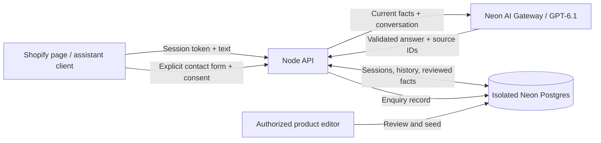

# Velani website assistant

The website assistant gives product advice and accepts explicit enquiries. It has a separate database from NEVORA employer accounts. It cannot read employees, wages, schedules or credentials, and it cannot perform payroll operations.

## Intelligence

Release 0.2 is configured with `gpt-6-astra`, compared with the original `gpt-6-1-sol` baseline using models confirmed in this development project's gateway catalog on 2026-11-02. The small comparison found a slight practical preference for Astra and successful structured-plan validation; it does not establish a universal winner. The model is configurable; there is no automatic downgrade. Its application context differs from ChatGPT, and comparable quality requires evaluation, current product knowledge and careful deployment.

The assistant receives a server-owned conversation window, a stable instruction hierarchy, and reviewed knowledge. It can reason about a visitor's workflow, compare described needs against documented capabilities, remember details inside that window, and ask one useful next question. It should distinguish practical suggestions from verified product features.

The database stores the conversation; the model sees the latest 40 messages, capped at 32,000 characters. This is bounded session memory, not a complete permanent customer profile. A bearer token lives only in browser memory and expires after 24 hours by default. Reloading the example client starts a new session.

The initial bilingual corpus is small: full-text ranking plus always-included core product constraints makes all reviewed facts available without an embedding service. The schema includes pgvector, but vector search is not used yet. Add evaluated hybrid retrieval when the corpus becomes large enough to need it; do not describe this version as semantic vector retrieval.

## Knowledge and honesty

Current source review: 2026-11-02. Expiry: end of 2026-12-02 UTC. An editor must re-check facts and extend the dates; expired sources are excluded. No available knowledge produces a clear human-help response instead of unsupported product answers.

- NEVORA is described as in development and offered by quote.
- No public price, immediate onboarding or release date is promised.
- Payroll calculations and statements do not mean wage payment or tax filing.
- English/Spanish is documented for the time-clock interface; whole-platform language coverage is unverified.
- The preview demonstration is illustrative and not a real employee clock-in.
- Certifications, integrations, customer metrics and security guarantees require verified evidence.

Model output is JSON-validated. Source IDs must map to current supplied first-party articles. The client receives source metadata from the server, not arbitrary URLs chosen by the model. These checks stop invalid citations and unsafe rendering; they do not prove every natural-language claim. Review real conversations and rerun the evaluation suite before publishing revised prompts, models or source material.

## API and persistence

Every `/v1` mutation requires an exact allowed Origin header. Protected GET requests still require authentication but may omit Origin for same-origin browser requests. A supplied disallowed origin is rejected. Session bootstrap requires Turnstile in production, with action `velani-session` and matching hostname. Origin checks are browser controls, not an identity guarantee; rate limits and CAPTCHA handle anonymous abuse.

Bearer tokens are random 256-bit values stored only as keyed hashes. Requests can access only their authenticated session. The browser cannot supply system instructions, history or database identifiers to override this scope.

Chat requests use a client-generated UUID. The same UUID and payload replay a completed answer. A changed payload conflicts. A transaction serializes requests for each session; an expiring, fenced lease prevents stale completions overwriting newer work. A database-backed quota bounds requests across service instances. A model failure releases the claim for an intentional retry. A provider may still charge for an interrupted generation.

Leads are written only through `/v1/leads` with `consent: true` and `consentVersion: lead-v1`. The model has no tool that saves a lead, sends email or books a meeting. Submission is idempotent. Successful submission means an enquiry was saved in Neon; it does not mean anyone received a notification. Operations must review the lead queue, or implement a separate authorized notification workflow later.

## Privacy and operations

No request bodies, credentials, IP addresses or raw model-provider errors are intentionally logged. Rate-limit IP keys use a server HMAC secret. Free-text conversations may contain personal details supplied by the visitor; disclose processing and discourage credentials, identity documents and employee records. Selected conversation context is sent to the configured AI provider through the gateway.

The supplied retention job defaults to chat records older than 30 days and enquiries older than 90 days. It is a dry run unless `--apply` is passed. Hosting must schedule the apply job daily for the stated retention policy to be true. Deleting a chat deletes its messages immediately and detaches existing enquiries; enquiry deletion requires a verified operator request. Database backup retention is a separate Neon setting and must be included in the published privacy policy.

Run the public service with a restricted application database role; keep owner credentials only in administration jobs. The public service should not hold migration credentials. Keep `TRUST_PROXY=false` for direct connections, or configure an explicit trusted ingress IP/CIDR list when behind a proxy. Boolean `true` is rejected: blindly trusting public forwarded headers undermines IP quotas. Confirm which proxy address and sanitized forwarded headers your host actually supplies.

The development request cap is 500 generations per rolling 24-hour window, plus session and IP limits. It is a request cap, not a dollar budget: token use and provider pricing vary. Set gateway/provider spending alerts and a budget before production traffic.
